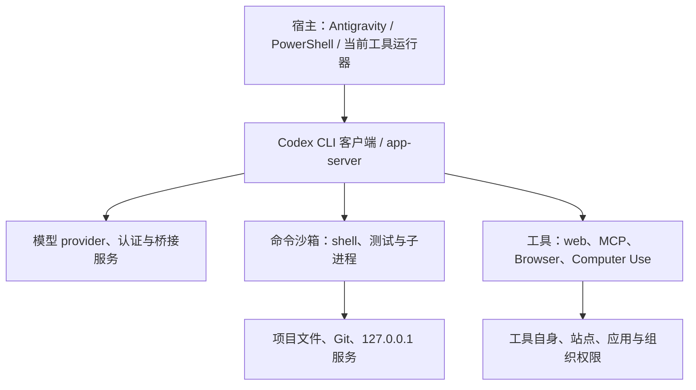

# Codex CLI 调用、权限与项目规则审查

审查日期：2026-11-01（Asia/Singapore）

项目：`C:\Users\d\Documents\dict`，Open-Lexicon 25K

审查基线：`c8d278e`；本机 `codex-cli 0.159.2`、Windows PowerShell `5.1.26100.9711`。

审查对象为根目录 `RULES.md` 与用户指定的 `C:\Users\d\Desktop\ai\USER_COLLABORATION_PROFILE.md`。同时核对了实际加载入口、用户级配置、项目实现、CLI 帮助和当日 OpenAI 官方文档。本文中的配置、命令与规则替换段落均为建议稿；没有修改被审查文件、全局配置、代理设置或应用权限。

并行变更说明：初始检查没有根 AGENTS.md；收尾时发现其他工作新增了未跟踪的根 AGENTS.md（846 字节，修改时间 2026-11-01 10:36:59）。已读取并保留，未纳入本次提交。它已加入 RULES.md 指针，因此入口缺失已有补救；但同时复制了性能承诺与“物理弹簧”等原问题，建议按第 7.1 节精简。新入口也不使已经启动的会话自动重新加载全部规则。

## 1. 结论与本项目推荐配置

现有规则的沟通目标与自主推进原则可以保留，但将职责约定、技术能力、历史事故和目标性能写成同等强度的“铁律”，会造成权限误配、无效等待甚至丢失工作。优先修正四项：规则加载入口、本地网络分层、stdin/队列协议，以及协作手册中的自动硬回退。

**按目前“Antigravity 调度、Codex 生产”的分工，推荐让 Codex worker 使用 `workspace-write`，无人值守时使用 `never`，需要访问项目 HTTP 服务时显式开放命令网络；由宿主执行已授权的 Git 提交与服务启停。** 这条路线能保留项目写入边界，也避免每次提交都让 worker 申请越界权限。

如果改为 **Codex 一体承担代码、Git 和本机运维**，`danger-full-access` 配合 `never` 的确最少阻力，也与本次会话的执行权限一致。但这意味着放弃 Codex 命令沙箱对本机文件系统与命令网络的限制，`-C` 仅指定工作根目录，不能继续承担隔离作用。它不能修复宿主网络隔离、网关 502 或浏览器插件未授权。不要把全权限写成“访问 localhost 的技术前提”。

| 使用场景 | 调用选择 | 实际边界与适配建议 |
| --- | --- | --- |
| 独立只读审查 | `-s read-only`，无人值守 `-a never` | 适合阅读源码、产生审查结果；需要落盘报告时由宿主接收输出，或改用有明确写入范围的 worker。命令只读沙箱不自动限制所有外部工具副作用。 |
| 本项目常规自动生产，推荐 | `-s workspace-write -a never` | 允许普通项目文件改动；需要 HTTP 验证时加 `-c sandbox_workspace_write.network_access=true`。边界外动作失败后交宿主处理，不能静默放大权限。 |
| 交互开发，需要偶发越界 | `-s workspace-write -a on-request` | 允许沙箱内连续工作，越界时按实际授权处理。不是每个命令都审批。 |
| 希望减少交互审批 | `--approve-for-me` | 本机支持；以自动审查处理符合条件的审批请求。它可能拒绝操作并增加模型开销，不等于无条件放行；不要与 `never` 拼成一个“万能组合”。 |
| Codex 独立完成可信本机批次 | `-s danger-full-access -a never` | 最顺畅但边界最宽。仅在该批次已有相应授权、且确实需要这种职责范围时选择，不提升为全局默认。 |
| 已有外部隔离环境中的全开放执行 | `--dangerously-bypass-approvals-and-sandbox` | 本机帮助明确定位为外部已有沙箱时使用。它关闭 Codex 自身确认与命令沙箱，不授予 Windows 管理员、UAC、插件或远程平台权限。 |

模式与审批是两个维度；`never` 的含义是“不请求升级审批，执行失败返回模型”，不是“所有动作自动获准”。`workspace-write` 还保护 `.git`、`.codex` 等路径，不能假设在工作区内就能自动提交或修改 Codex 配置。上述边界依据 [Agent approvals & security](https://learn.chatgpt.com/docs/agent-approvals-security)、[Auto-review](https://learn.chatgpt.com/docs/sandboxing/auto-review) 及本机 `--help`。

## 2. 已核实的本机事实与证据限度

| 检查项 | 观察结果 | 能说明什么 |
| --- | --- | --- |
| CLI 命令入口 | `Get-Command codex -All` 同时发现 npm 安装的 `codex.ps1`、`codex.cmd` 等入口；当前优先解析 `.ps1` | shell 与包装脚本会影响引号、编码和输入转发；不能把所有问题归给 Codex 本体。 |
| 版本与命令 | `codex --version` 为 `0.159.2`；实际帮助包含 `exec`、`queue`、`agents`、`--approve-for-me` | 此版本确实有队列功能；“Codex 没有 queue”同样是错误判断。 |
| 全局默认 | `.codex/config.toml` 为 `gpt-6.1-sol`、推理 `high`、`service_tier="default"`；`[features].fast_mode=true` | 仅证明已配置；不能据此断言该次请求已走 Fast 服务或账号一定具有对应额度。 |
| Windows 实现 | 用户配置 `[windows] sandbox="unelevated"` | 这是沙箱实现选择；与 `workspace-write` 等权限模式不是一回事。本次全访问会话不因此变为受限运行。 |
| 项目配置 | 本项目已被用户配置标记为 trusted；未发现项目 `.codex/config.toml`；根 AGENTS.md 在收尾时由其他工作新增 | 尚无项目级持久权限配置；新增指令入口仍需精简，不能与运行时权限配置混同。 |
| 当前会话 | 宿主提供 `danger-full-access`、审批 `never`，并声明 browser/computer-use 工具 | 只说明当前会话边界；不证明另起 `codex exec` 会继承相同权限、工具和 app 授权。 |
| 项目服务 | 宿主侧绕过环境 HTTP 代理，请求 `127.0.0.1:8765/api/stats` 成功，返回 `status=ok`、25,006 词头、58,574 义项 | 证明当前服务可达与计数；不证明搜索性能、数据语义正确或 UI 验收完成。 |
| 桥接服务 | `127.0.0.1:17841` 在监听；`GET /v1/models` 返回 HTTP 502 | 请求已到达 HTTP 服务链路；不能归因为宿主回环端口完全不可达，也不能证明模型推理可用。未验证它是否为此 Codex 实例所用 provider。 |
| Ollama | `127.0.0.1:11434/api/tags` 连接被拒绝，监听列表亦未见该端口 | 手册“本地常驻运行”是历史记录，不能当成当前事实。未启动或重配它。 |
| 多行传递 | PowerShell 将含中文与换行的变量作为一个 Python 原生参数传入，`argc=1` 且换行保留；UTF-8 stdin 也保留中文与换行，管道另加行尾 | 反证“Windows CLI 必在首个换行截断”的普遍断言；没有测试真实 `codex queue` 投递或模型端到端生成。 |

检查未运行新的模型生产请求、未发送任何队列消息、未重启服务、未切换沙箱实现或代理、未进行发布与推送；未重跑 25K 数据生产及全量门禁。网络探测使用 3 秒超时，只在当前宿主权限下执行，不冒充受限 Windows 沙箱的连通性验证。

## 3. 架构与权限：必须拆开的五层



### 3.1 外层宿主限制不会被内层 CLI 参数解除

若 Antigravity 启动 Codex 的外层进程已经被容器、Windows 令牌、网络规则或代理限制，内层追加 bypass 不能获得外层没有的能力。反过来，宿主成功访问 8765，也不证明 Codex 生成的 shell 命令成功。应分别检查宿主与实际 worker，不在能力未确定时反复尝试同一参数。

### 3.2 模型连接不等于模型生成命令的网络

Codex 客户端向模型 provider 发请求，与它生成的 `curl`、Python、Node 子进程访问 HTTP 服务，是不同流量路径。官方明确将客户端模型/认证请求、MCP、搜索、浏览器等排除在命令网络代理过滤范围之外。因此：若 `17841` 是 provider 的 `base_url`，先查客户端与网关；若是测试脚本主动调用它，再查命令沙箱网络。嵌套 `codex exec` 若从另一个受限 shell 启动，外层限制仍可能影响整个子进程。依据：[Agent approvals & security：命令代理之外的流量](https://learn.chatgpt.com/docs/agent-approvals-security#traffic-outside-the-command-network-proxy)。

### 3.3 localhost 的可达性需要条件，不必然要求 bypass

本项目留在原生 Windows/PowerShell 路线最方便，暂无为本次规则审查迁移 WSL 的必要。`workspace-write` 下可显式启用命令网络；如果还启用了受管网络代理或域名限制，应另外核对本地地址例外及 `allow_local_binding` 等策略。`network_access=true` 本身不是“只开放 8765”，也不保证所有宿主防火墙和网关都放行。依据：[Permissions](https://learn.chatgpt.com/docs/permissions)。

排障顺序建议：确认目标 PID/监听地址 → 在宿主执行有超时的只读请求 → 在实际 worker 中重复同一请求 → 对照状态码、异常与日志 → 再判断 provider、命令网络、代理、IPv4/IPv6 或跨 WSL/容器地址差异。示例：

```powershell
# 仅直连这一条本地诊断请求，不修改系统代理。
curl.exe --noproxy 127.0.0.1,localhost --connect-timeout 2 --max-time 5 http://127.0.0.1:8765/api/stats
```

只有 TCP 拒绝、连接/读取超时、HTTP 401/403、HTTP 502 等具体证据，才能支持对应诊断；“Token 不动”无法定位到沙箱。不要为诊断而向 `0.0.0.0` 暴露本地桥接或关闭全局防火墙。

Windows 沙箱实现又是独立维度。当前使用 `unelevated`，其网络隔离弱于 legacy `elevated`。最新官方页面还介绍 MXC，但其中部分诊断明确要求 CLI `0.162.0+`，不能原样套在本机 `0.159.2`。本轮不建议盲目切换实现；先在现有实现上验证。依据：[Windows sandbox](https://learn.chatgpt.com/docs/windows/windows-sandbox)。

### 3.4 browser/computer-use 有自己的入口与授权

| 能力 | 正确用途 | 不能从 shell 全权限推导出的结论 |
| --- | --- | --- |
| HTTP/CLI 请求 | 服务状态、结构化接口、构建和测试 | HTTP 200 不证明页面渲染、键盘导航、朗读或视觉效果正确。 |
| 内置 Browser | 优先验证正在开发的本地 Web 页面 | 它不是 `--search`；必须有对应工具和目标 URL 访问权限。 |
| Chrome/Edge 连接 | 用户指定现有浏览器、标签页或登录态时使用 | 需要连接器/扩展、对应浏览器会话与站点授权；父会话可用不代表子 CLI 自动可用。 |
| Windows Computer Use | 必须通过桌面 UI 观察或操作的流程 | 应用许可、桌面状态与工具运行时独立存在；bypass 不能代替 app 授权。 |

本次只确认工具声明与本地插件配置，没有声称真实浏览器/应用授权已验证。执行 UI 工作时，以当前会话工具清单和对应 skill 的初始化、控制与确认规则为准；不要将某次缓存里的 API 名、内部端口或 `node_repl` 写死为跨宿主通用协议。工具缺失时可完成 CLI/API 范围的验证，并明确剩余 UI 检查；不可报告“全功能通过”。依据：[Browser](https://learn.chatgpt.com/docs/browser)、[Computer Use](https://learn.chatgpt.com/docs/computer-use)。

### 3.5 Markdown 不是权限配置或强制执行器

`RULES.md` 约束助手行为，不能开启 sandbox 网络、授予插件访问、产生跨会话通信能力，也不能限制已有全访问进程的实际文件权限。Codex 的 execpolicy `.rules` 文件与此 Markdown 是不同机制；`--ignore-rules` 也不是“关闭 RULES.md”。命令规则不能自动覆盖所有 MCP、Browser 和 Computer Use 路径。依据：[Rules](https://learn.chatgpt.com/docs/agent-configuration/rules)。

## 4. 可直接采用的调用方式

### 4.1 持久配置草案

若采用推荐 worker 路线，可在可信项目的 `.codex/config.toml` 中保存以下差异；不要覆盖整个用户级配置，以免破坏已有 provider、插件与认证配置。

```toml
model = "gpt-6.1-sol"
model_reasoning_effort = "high"
sandbox_mode = "workspace-write"
approval_policy = "never"

[sandbox_workspace_write]
network_access = true
```

该项目已有 trusted 标记，满足项目配置加载的信任前提。网络开关适用于确实需要 HTTP/依赖访问的开发 worker；纯文件生产可关闭。`never` 适合无人值守，交互开发可覆盖成 `on-request`。常规配置优先级为 CLI 覆盖 > 项目配置 > profile 文件 > 用户配置等，而强制要求另行约束可选值；命令行不能越过组织强制策略。依据：[Config basics](https://learn.chatgpt.com/docs/config-file/config-basic)。

本机 `-p` 帮助指向 `$CODEX_HOME/<name>.config.toml`。如采用 profile，先核对此版本格式，不要从旧教程机械复制 `[profiles.xxx]`。同理，本机帮助没有 `--full-auto`，应采用上述显式参数。依据：[Advanced Configuration](https://learn.chatgpt.com/docs/config-file/config-advanced)、[Non-interactive mode](https://learn.chatgpt.com/docs/non-interactive-mode) 及本机帮助。

### 4.2 PowerShell 5.1 的 UTF-8 stdin 派发草案

先由调度方在项目 `.tmp` 中准备唯一任务文件，写清本批目标、允许路径、基线、验收与输出位置。任务正文通过 stdin，避免长参数和多层 shell 拼接：

```powershell
$codexProject = 'C:\Users\d\Documents\dict'
$codexRunId = [guid]::NewGuid().ToString('N')
$codexRunDir = Join-Path $codexProject ('.tmp\codex-' + $codexRunId)
$codexPromptPath = Join-Path $codexProject '.tmp\task.md' # 调度方预先写好
New-Item -ItemType Directory -Path $codexRunDir -Force | Out-Null

$codexPreviousOutputEncoding = $OutputEncoding
$codexPreviousConsoleEncoding = [Console]::OutputEncoding
try {
    $OutputEncoding = New-Object System.Text.UTF8Encoding($false)
    [Console]::OutputEncoding = New-Object System.Text.UTF8Encoding($false)
    $codexTaskText = Get-Content -Raw -Encoding UTF8 -LiteralPath $codexPromptPath
    $codexTaskText | codex -a never exec `
        -C $codexProject -m gpt-6.1-sol `
        -s workspace-write `
        -c model_reasoning_effort=high `
        -c sandbox_workspace_write.network_access=true `
        --json -o (Join-Path $codexRunDir 'final.md') - `
        | Set-Content -Encoding UTF8 -LiteralPath (Join-Path $codexRunDir 'events.jsonl')
    $codexRunExitCode = $LASTEXITCODE
} finally {
    $OutputEncoding = $codexPreviousOutputEncoding
    [Console]::OutputEncoding = $codexPreviousConsoleEncoding
}
if ($codexRunExitCode -ne 0) { throw ('Codex exit code: ' + $codexRunExitCode) }
```

这是基础派发样例，未运行模型端到端测试。生产调度仍需为每个任务准备唯一输入文件，加入总时限、日志停滞告警、取消与退出状态检查，并同步消费 stdout/stderr。样例分别设置发往原生进程的编码与读取其输出时的控制台编码，并在结束后恢复。`Set-Content -Encoding UTF8` 在 Windows PowerShell 5.1 会写 BOM，下游解析事件文件应接受 UTF-8 BOM（如 Python `utf-8-sig`）。不要假设 PowerShell 5.1 的原生 `>` 重定向就是 UTF-8。

本机 `.ps1` 启动器明确转发管道输入。`exec` 帮助说明：未传 prompt 或传 `-` 时从 stdin 读取；若同时传文字 prompt 和管道，则管道内容作为附加 `<stdin>` 上下文。普通模式 final 在 stdout、进度在 stderr；`--json` 才将 stdout 切成 JSONL。不要把 `2>&1` 混流当作干净 JSONL。依据：[Non-interactive mode](https://learn.chatgpt.com/docs/non-interactive-mode)。

若本批已选择让 Codex 直接承担 Git 与运维，可将命令权限部分替换为 `-s danger-full-access` 并保留前面的 `-a never`；无须再叠加 bypass。若明确选择 bypass，则用该标志取代这组权限选择，避免重复配置掩盖真实意图。两者都不是扩大任务授权范围的依据。

### 4.3 queue、resume 与 app-server 的边界

本机 `codex queue --help` 要求 `--thread` 与 `--message`，没有声明从 stdin 读取消息正文。不能写成 `Get-Content task.md | codex queue ...` 并假设等价于 exec。适合队列的形式是发送短文本及交接文件位置：

```powershell
# 仅为草案；本次未向任何会话发送消息。
codex queue --thread '<已核实的目标 UUID 或精确会话名>' --message '交接文件：C:/Users/d/Documents/dict/.tmp/task.md；按文件中的任务 ID、基线与验收处理。'
```

`queue` 是向已有会话排队投递消息；`exec` 是新非交互任务，`exec resume` 是继续指定会话。不要对同一正在写入的会话/工作树再启动并行 resume，也不要把“入队成功”当成“已执行并通过验收”。固定 Supervisor UUID 只有在对应本地/远程 app-server、存储和权限确实可用时才有意义；它不是任意模型通用的联络地址。依据：[Developer commands](https://learn.chatgpt.com/docs/developer-commands)。

当前阶段使用 exec + 任务文件 + JSONL 足够。需要持久连接、实时进度、审批和双向调度时，再接入 app-server 的结构化协议，不为解决多行文本问题先造一套代理平台。依据：[Codex App Server](https://learn.chatgpt.com/docs/app-server)。

调度方应持续读取事件，在进程退出、`turn.failed`、超时等状态更新任务；拿到 final 后仍核对目标文件、检查结果及 Git diff。宿主若没有自动回调能力，就使用有界等待或低频状态查询，不能承诺“所有宿主自动唤醒”。初始健康检查建议 2–5 秒；模型任务总时限按批量大小设置。无输出仅触发诊断，不立即杀掉正常长测试，也不无限重试。

## 5. RULES.md 逐条问题与修订建议

行号以审查基线为准；“优先级”表示修订次序，不将普通规则审查包装成生产事故。

| 优先级 / 定位 | 问题与影响 | 建议修订 |
| --- | --- | --- |
| 高；文件入口、首段基准来源 | Codex 默认识别 AGENTS 指令链，`RULES.md` 与任意绝对路径手册不会因存在就自动注入。本机全局 AGENTS 指向另一个较旧手册。收尾新增根 AGENTS 已指向 RULES，但重复了一部分原规则问题。 | 将新增入口精简为极短 `AGENTS.md` 指针；已有入口后无须再叠加 fallback。外部基准文件标注唯一权威来源与适用边界。 |
| 高；一.2–3，约 20–28 行 | “Antigravity 项目脚手架搭建”“Codex 唯一代码创作者”存在交叉；允许前者先搭结构再交后者，和桌面手册“严禁编写生产级业务代码”也有歧义。 | 明确 Antigravity 可建目录、调度、运行构建与检查；业务实现交 Codex。若具体脚手架包含业务实现，纳入同一任务授权与审查。任一批次保持一个代码写入者和一个提交责任人。 |
| 中；一.3 | 把“全量单元测试补充”作为 Codex 固定职责，无视改动范围与现有测试设施。 | 按受影响行为执行必要验证；文档小改不新造测试工程。重要改动由独立只读审查复核关键差异，不以作者自审替代项目要求。 |
| 高；二.1–3 | “所有报错挡在幕后”“全部无缝串联”“致命阻断”没有定义工具缺失、未授权外部动作等情况。 | 用户只接收影响结果的原因、已尝试路径与最短下一步；常规排障自行完成。真实阻断包括权限拒绝、缺少必要身份或重要产品选择，禁止隐瞒失败。 |
| 中；二.4，约 40 行 | 60–80K Token/30–40 轮是经验阈值，不是稳定技术边界；可能读不到精确占用，也忽略原生 compaction。机械要求新会话会打断已授权执行。 | 用可用上下文、压缩状态与任务连续性判断；在稳定里程碑保存状态，必要时交接。轮数只作提醒，不作强制终止条件。 |
| 中；三.1–2 | 平铺与实体按钮是明确产品偏好，可保留；但“点击即朗读”不能保证所有浏览器/系统语音可用或离线。 | 保留布局目标，增加播放失败、无语音、加载/取消反馈与键盘支持；离线语音能力另行验证，不把浏览器 API 名称当质量保证。 |
| 中；三.3，约 54–59 行 | `cubic-bezier(0.16,1,0.3,1)` 是缓动曲线，不能等同物理弹簧模型；只用 transform/opacity 也不是绝对 GPU 或流畅保证。引用源未给版本与可核查位置。 | 写成“优先使用”，按可访问性与性能证据例外处理；支持 reduced motion。`active:scale-[0.98]` 为 Tailwind 语法，不适合作为所有技术栈强制实现；Windows 搜索快捷键补 Ctrl+K，并避开输入框冲突。无需因本轮审查联网研究该设计库。 |
| 保留并澄清；三.4 | 实用现代构词与整词记忆原则合理，但“前缀+词根+后缀”不能强迫每词都有三段。 | 仅在语言事实支持时拆分；把现代构词、历史词源与记忆法标识清楚，保留本项目字段契约。 |
| 高；四.1，约 65–68 行 | 把“客户端分片索引+Worker”写成已确定且已生效的事实；检查到 `app/static/app.js` 仍请求 `/api/words`、`/api/word`，`app/server.py` 仍有多个 LIKE 查询。 | 明确“现有服务”与“目标静态前端”两条状态；用可验收迁移任务替代“彻底废除”的完成式断言。源码中有 FTS5 资产也不能证明每条查询都走索引。 |
| 高；四.1 | “所有搜索 <1ms”“100% 客户端”“零服务器算力”缺少测试口径。静态资源传输、索引下载/解析、主线程渲染、Worker 通信都存在成本。 | 将 <1ms 限定为待验证的纯索引查询目标；另测冷启动、内存、端到端 P50/P95 与弱设备表现。静态托管写成“无自建检索后端”，免费服务额度不等于无限零成本。 |
| 高；四.1 与现有产物 | 根目录 `验收工作台.html` 约 188.6MB，且在 `.gitignore` 中；构建脚本将词库内嵌到 `const DB`。它不能直接充当已完成的轻量分片 Worker 方案或默认发布入口。 | 定义可部署产物、体积预算与全新浏览器加载检查。本文未对该巨大 HTML 做完整性能或视觉审计。 |
| 中；四.2 | 零付费 API 是有效预算约束，但本地桥接 URL 并不证明下游免费；订阅 CLI 也不等同 API 计费账户。 | 保留零新增计费要求，按 provider/auth 路由确认；不得为修复网络悄悄切换付费 key、provider 或提高成本档位。 |
| 高；四.3，约 71–72 行 | “凡修改核心数据/服务逻辑必须重启”过度泛化；重启可能影响任务。静态文件刷新、缓存更新、SQLite 新连接与常驻内存快照的生效机制不同。 | 按实际加载路径选择刷新、缓存失效或目标进程重启，再验修改的具体行为。`/api/stats` 只能验证计数，不能代替内容与 UI 检查。 |
| 高；四.4，约 73–74 行 | “闭环立即 commit”未指定提交者、文件范围与 `.git` 写权限；在受限 worker 下会阻断。 | 单一提交者仅暂存本批文件，检查 diff 后本地提交；worker 用宿主提交路线或预先选定的全访问模式。提交不自动授权 push、发布或分支重写。 |

规则发现的正式机制是全局/项目 `AGENTS.override.md`、`AGENTS.md` 和配置的 fallback；同层不是自动把所有规则文件全部加载。用 AGENTS 指针保留 RULES 单一正文更适合本仓库。依据：[Custom instructions with AGENTS.md](https://learn.chatgpt.com/docs/agent-configuration/agents-md)。

## 6. 协作手册的具体问题

此处只审查影响 Codex 技术适配、权限与本项目隔离的条款，不重新裁定其他工程产品要求。

| 优先级 / 位置 | 审查判断 | 修订建议 |
| --- | --- | --- |
| 最高；三.1，75 行 | 发现 Antigravity 越权便 `git reset --hard` 会丢弃其他未提交修改，也无法按作者/任务精确回退；不是权限惩戒机制。 | 删除自动硬回退。先停止相关写入、保留 diff、识别受影响文件/提交，再在明确范围内恢复或 revert。共享工作区不以角色违规为由清除所有人的工作。 |
| 高；桌面版与 `.codex` 版分叉 | 桌面版 16,979 字节、修改于 2026-10-27；全局 AGENTS 指向的 `.codex` 版 10,935 字节、修改于 2026-10-22。两版对 Astra 是“允许协同”与“全面停用”，并有配额/职责差异。 | 指定唯一权威来源，另一处只保留明确指针，或采用单向生成并标明源。不要假设新文件会自动取代已加载指令。本轮按用户指定桌面版做审查，未修改全局入口，也未调用替代模型。 |
| 高；二.2，43–50 行 | 根级 `fast_mode=true/false` 写法含糊。本机实际是 feature 开关 true，但 service tier 为 default；速度、推理 effort、并发是三个独立旋钮。 | Fast 需对应服务档位和模型/账号支持；若选 Fast，当前官方形式为 `service_tier="fast"` 加 `[features].fast_mode=true`。Normal 用 default tier，high 独立设置。不能从 feature 开关 alone 判断加速已生效。 |
| 高；二.2 的 3 / 5–7 并发 | 无账号上限、文件隔离、写入锁或失败退避依据；会增加竞争与额度消耗，不能称为固定“稳健”配置。 | 默认一个主写入者；只读审查或互不重叠任务按必要性并行。批量生产基于明确预算和实测吞吐调并发，遇容量/限流有界退避，不自动加并发冲额度。 |
| 中；二.3，52–55 行 | 字数、Tokens、瓦特/能耗和实际账单是不同指标；JSONL usage 往往是 turn/run 粒度，不能自动精确归因每篇。 | 记录任务 ID、实际可用 usage、耗时和验证；未暴露的数据标“未提供”，不得用字数估算后伪装实测 Token 或电力。只在真实批量任务维护台账。 |
| 高；三.1 的固定 Supervisor UUID | 没有宿主/daemon、目标会话可用性与回执协议；文本 UUID 不会自动产生跨产品通信能力。 | 会话 ID 属于当次调度配置；先验证可达与授权，用任务 ID 和结果文件闭环。不能为了避免人工传话而虚构已派发成功。 |
| 中；三.2 的真实学习库与端口 | `learning.sqlite3` 的约束属于其他工程，不应把本项目发布词库当作该库；18745/4317 也不属于 dict 服务。 | 仅将相关约束随目标工程加载。本项目服务为 8765，17841 仅在本批确实依赖桥接时检查；不读取其他工程学习数据。 |
| 高；三.2 的 Obsidian 同步，89–91 行 | 跨目录复制与 UI 热刷新不是一个文件系统事务，无法保证“毫秒级”或双向无冲突；此项目也未声明 Obsidian 镜像需求。 | 移至知识库工程专属规范，明确单向源、目标、冲突策略、验收。不得从共享手册推导出向活动 vault 覆盖本项目文件的授权。 |
| 高；三.2 Git 双分支，92–93 行 | 强制 main/master 同步与实际分支策略无关，可能覆盖其他工作；本项目当前主分支是 main。 | 服从仓库现有分支约定，不自动创建/移动 master，不隐含 push 或 force。 |
| 高；三.2 Windows 多行，94–96 行 | 将历史截断归纳为解析器必然行为不准确。本次原生参数实验完整保留换行；引号和编码确实会出问题。 | 改成“长文本优先 UTF-8 stdin/交接文件，按子命令实际支持选择；避免多层 shell 拼接，核验 Unicode、行尾、退出码”。queue 与 exec 分开说明。 |
| 高；五.2，148–150 行 | 将默认沙箱、provider 通信、外部进程与回环 API 混在一起；任意外部进程不必然需要网络。无限挂起也可能来自桥接错误、重试、管道阻塞或仍未关闭 stdin。 | 替换为第 3 节分层诊断，显式超时与日志；先证明失败发生在哪一层，再决定最小权限调整。 |
| 高；五.3，151–153 行 | 假设所有宿主都有事件完成自动唤醒机制。Codex exec 可以流式交付事件，但外层 Agent 是否恢复由宿主决定。 | 有回调就订阅；没有就采用工具支持的有界等待/状态检查。避免高频无限轮询，不禁止一切合理 polling。 |
| 中；五.4–5 与六.3 | 硬件、Ollama、代理、端口被写成实时事实；“一开全局代理必报502”也过度绝对。 | 标注为历史环境记录；只按本批依赖探测。优先用单次 no-proxy 诊断，不擅自更改代理模式；不用设备名/历史吞吐代替当前健康检查。 |
| 中；一.4 与六.4 | 固定 Token/轮数强制换会话，固定三句话宣告健康，可能诱导未检查就报告门禁通过。 | 沿用里程碑与上下文状况判断；汇报仅包含实际完成和检查证据。文档审查无需为迎合模板启动所有工程服务。 |

Fast 的真实可用性和消耗规则以账号及服务路径为准，不能推定本地桥接实现了官方档位语义。官方 Fast 与推理 effort 是不同配置，且加速会提高用量消耗；本文不替账号承诺费用或额度。依据：[Speed](https://learn.chatgpt.com/docs/agent-configuration/speed)。并行需要可分离职责与上下文，不等于同时修改同一个工作区；参考 [Subagents](https://learn.chatgpt.com/docs/agent-configuration/subagents)。

## 7. 可替换进 RULES.md 的技术条款草案

以下为需要合并到现有章节的替换段落，不建议再建立第二份并行总规则。

### 7.1 规则入口与适用边界

> 本项目根目录 AGENTS.md 为 Codex 自动发现入口，指向本 RULES.md；正文保持单一来源。新任务先读取本规则及与任务相关的现有交接信息，不加载无关工程配置。用户协作手册仅提供通用偏好；其他工程端口、数据、镜像和职责不得自动带入本项目。规则文档不授予运行时权限；以当前宿主、CLI、插件与强制策略的有效权限为准。

根 `AGENTS.md` 可只保留：

```markdown
# Open-Lexicon 25K

- 开始本项目实质任务前，读取根目录 RULES.md，并遵守其项目约束。
- 接手或需要项目状态时，读取 docs/PROJECT_HANDOFF.md 中与当前任务相关的部分；历史状态与当前代码冲突时核对实际证据。
- Windows PowerShell 使用 Get-Content -Encoding UTF8 读取 UTF-8 Markdown。
```

### 7.2 调度、权限与职责

> Antigravity 负责调度、环境、检查、服务生命周期与约定范围内的 Git 提交；Codex 默认使用 gpt-6.1-sol / high，负责业务代码与必要验证。每批只保留一个代码主写入者与一个提交责任人，独立审查默认只读。普通 worker 使用 workspace-write，无人值守使用 never；需要 HTTP 验证时显式开放命令网络。越界步骤由宿主在已有授权内完成。若用户已选择 Codex 独立承担整批 Git 与运维，可在启动时选 danger-full-access + never，并明确该模式没有项目文件隔离。bypass 不作为访问 localhost 的默认修复方法，不解除外层宿主、系统、工具或组织约束。

### 7.3 自动交接与失败处理

> 新任务用 codex exec 的 UTF-8 stdin 或交接文件；已有会话用版本支持的 queue/resume，按各子命令实际输入协议执行。每次记录任务 ID、目标工作根、基线、允许修改范围、验收、结果位置与退出状态；入队不代表完成。持续消费输出并设置合理总时限；失败先定位宿主、provider、命令沙箱或工具层，避免同条件无限重试。无法自动通信时如实报告具体缺口，不伪造回执，不让用户承担可自动完成的文本中转。

### 7.4 网络与 UI 验证

> 只检测当前任务实际依赖的服务。先确认监听，再用带超时的请求逐层验证；不以 Token 停滞判断网络权限。宿主可达与 worker 可达分别记录。HTTP 计数验证、搜索行为、浏览器交互和桌面操作分别验收；Browser/Computer Use 遵守当前会话工具入口、应用/站点授权及技能要求，shell 全权限不替代这些控制。

### 7.5 性能、内容生效与提交

> 客户端分片索引与 Worker 属于目标方案，完成前保留当前服务状态的准确描述。性能报告注明数据规模、设备、冷/热状态、内存和端到端口径；未实测不宣称所有搜索 <1ms。内容或代码落盘后，按实际加载方式刷新页面、失效缓存或安全重启本项目目标进程，再验证本批变更。通过必要检查后，仅提交本批相关文件；不清除未知改动，不自动硬回退，不自动同步其他分支。push、发布和跨目录镜像遵循各自授权。

### 7.6 上下文与汇报

> 在稳定里程碑保存已验证状态；按可用上下文、压缩情况和任务连续性决定是否交接，固定轮数仅作提醒。汇报说明成果、实际检查及未完成项；正常排障由助手处理，影响授权或结果的阻断应简明说明。在已授权范围内持续推进，只有真正未决的选择与权限才交给用户。

## 8. 手册应替换的四段高影响条款

**越权处理：**

> 发现代理超出职责范围时，停止该范围内的继续写入，保存当前差异并识别具体文件与提交。仅在确认影响范围、保全其他工作后恢复或回退相应变更；不得用自动 git reset --hard 作为通用惩戒。交给授权的主写入者接续。

**Windows 多行与网络：**

> Windows 的文本传递结果受 PowerShell 版本、原生参数绑定、CLI 包装脚本、Unicode 编码及子命令协议影响。长正文优先使用明确 UTF-8 的 stdin 或交接文件；stdin 仅适用于声明支持它的子命令。网络错误分别检查宿主、Codex 客户端 provider 连接、生成命令沙箱及目标服务；按证据最小调整，不将 bypass 设为默认前提。

**模式与配额：**

> 标准/Fast 服务档位、模型推理 effort 与并发独立管理。按当前账号与 provider 支持选择，未提供真实 usage 的指标标记未知。默认保持一个代码主写入者；批量任务在明确预算与隔离边界内按实测调并发，不以固定 5–7 并发或额度即将重置代替任务价值和验收。

**完成通知与上下文：**

> 宿主提供事件或回调时优先使用；否则使用工具支持的有界等待与低频查询。按任务里程碑和上下文状态更新交接，不强制在固定轮数新开窗口；正常任务继续在已授权范围内推进。

## 9. 落地顺序与本次交付边界

1. 先统一协作手册的权威来源，移除自动硬回退、跨项目隐含写入和固定双分支同步要求。
2. 将收尾新增的 AGENTS 精简为最短入口；采用第 4 节 worker 配置或明确的一体全访问配置，不同时混用两套责任分工。
3. 调度侧落实 UTF-8 stdin、唯一任务目录、结构化事件、退出码、超时和单一提交者。先做无敏感数据的小任务验收，再扩大批量。
4. 单独验证实际 worker 对 8765 的读取、预期文件写入与边界外拒绝；需要 Git/服务越界时验证宿主接管路径。若走全访问路线，改验任务范围和目标路径，不虚称沙箱仍在阻止越界。
5. 通过已授权 Browser/Computer Use 验证目标页面，再为客户端迁移单列性能基线与验收。不要为规则修订立即重写搜索前端或重新生成词库。

本次交付仅为此审查报告与修订草案。配置样例经过本机帮助与官方文档交叉核对，但未新启动模型 worker、未验证沙箱拒绝行为、未完成浏览器验收或 Fast 计费验证；这些项目不得记录为“已生效”或“已通过”。

主要依据除逐段链接外，还包括：项目 `RULES.md`、`app/server.py`、`app/static/app.js`、`src/build_acceptance_station.py`、现有交接文档；两处协作手册及全局 AGENTS 指针；本机 `codex --help`、`exec --help`、`queue --help`、`agents --help`、`sandbox --help`、`features list`；当日下载的官方 Codex manual。官方当前能力若新于本机版本，以本机实测帮助界定本机可用性，不将新版例子当作已验证能力。
